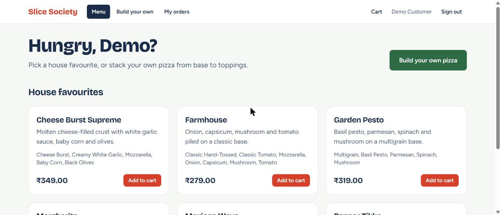
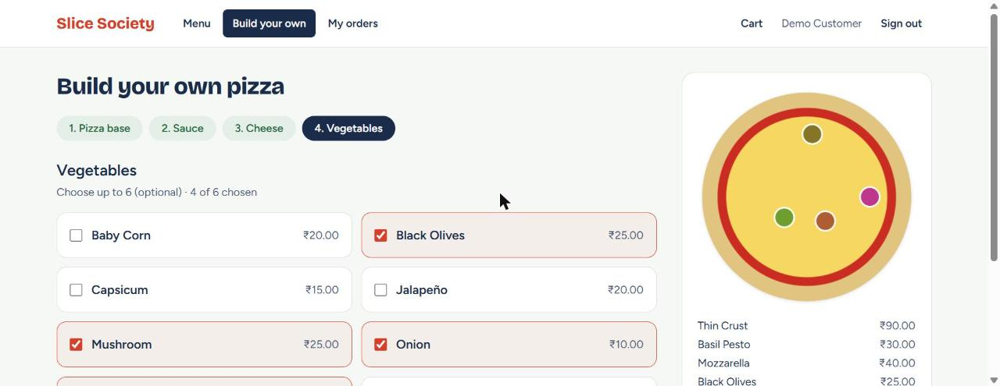
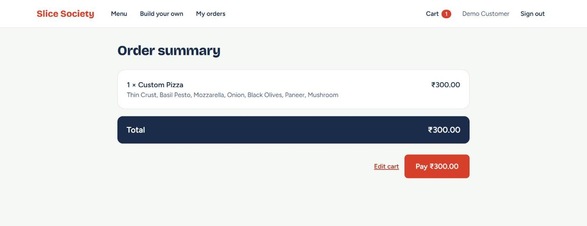
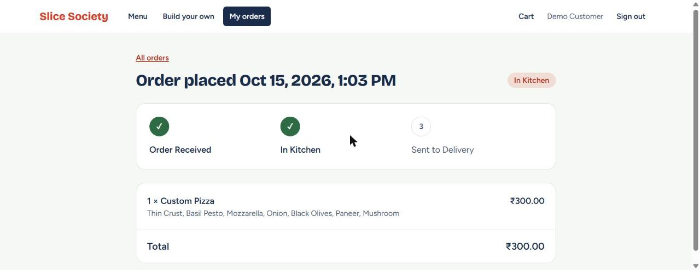
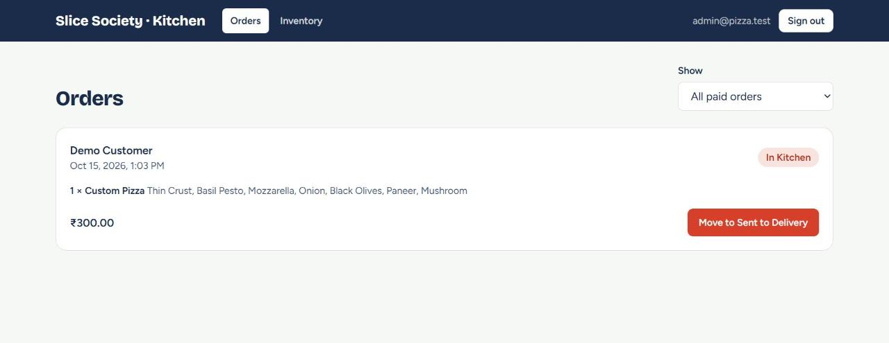
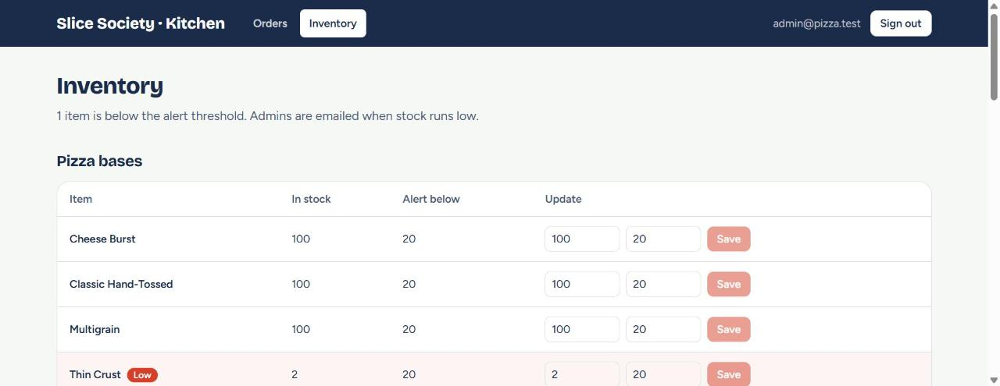

# Slice Society: Pizza Delivery Platform

Full-stack pizza ordering and inventory management app, built for the OIBSIP Web Development
internship (Level 3).

- **Customers** register with email verification, pick a house favourite or build their own pizza
  step by step, pay, and follow the order from "Order Received" to "Sent to Delivery" live.
- **Admins** sign in through a separate staff login, manage stock, get an email when an ingredient
  runs low, and move orders through the kitchen.

**Stack:** React 19 + Vite + Tailwind 4 · Node 22+ / Express 5 · MongoDB (Mongoose) · JWT ·
Razorpay (test mode) · nodemailer · node-cron.

## Screenshots

| | |
|---|---|
|  |  |
| House favourites | Builder: the pizza assembles as you choose |
|  |  |
| Server-priced summary before paying | Live tracker, updates without a refresh |
|  |  |
| Admin: paid orders, one click to the next stage | Admin: stock with a low-stock flag |

## Quick start (no accounts needed)

Requires Node 22.9 or newer and [pnpm](https://pnpm.io).

```bash
# 1. API with a throwaway in-memory database, seeded with menu, admin and a demo customer
cd server
pnpm install
pnpm dev:memory

# 2. Web app (second terminal)
cd client
pnpm install
pnpm dev
```

Open http://localhost:5173. `pnpm dev:memory` prints the demo logins:

| Role | Where | Login |
|---|---|---|
| Customer | `/login` | `customer@pizza.test` / `Customer-demo-pass-1` |
| Admin | `/admin/login` | `admin@pizza.test` / `Admin-demo-pass-1` |

Emails (verification, password reset, low-stock alerts) go to Ethereal's fake inbox: the server
log prints a **preview link** for each one, so nothing real is ever sent. Payments use a
built-in test checkout. The first start downloads a MongoDB binary (roughly 800 MB, once) and can take a minute or two;
if it reports a timeout, run it again.

## Local MongoDB (no Atlas, data kept between runs)

If you do not want to use Atlas, `pnpm dev:memory` forgets everything on exit and its in-memory
database can be slow to start on Windows. This runs one real local MongoDB instead:

```bash
cd server
cp .env.example .env      # set JWT_SECRET, plus ADMIN_EMAIL / ADMIN_PASSWORD for an admin
pnpm dev:local            # starts MongoDB, seeds the menu, creates the admin, starts the API
```

- The database runs as a background process on port **27018** with its data in
  `server/.cache/mongo-data` (git-ignored). It keeps running after you stop the API, so the next
  `pnpm dev:local` starts in seconds with your data intact.
- `pnpm db:status` shows whether it is running; `pnpm db:stop` shuts it down;
  `pnpm db:start` starts it without the API.
- `dev:local` always uses this local database, even if `MONGODB_URI` in `.env` points at Atlas.
- It needs a `mongod` binary. It uses `$MONGOD_PATH` if set, then the copy cached by
  `pnpm dev:memory` in `~/.cache/mongodb-binaries`, then `mongod` on your PATH. If you have none,
  install [MongoDB Community](https://www.mongodb.com/try/download/community) or run
  `pnpm dev:memory` once so a copy is downloaded.

## Running against MongoDB Atlas

```bash
cd server
cp .env.example .env     # fill in MONGODB_URI and JWT_SECRET at minimum
pnpm seed                # menu pizzas and ingredient stock (safe to re-run, never resets stock)
pnpm create-admin        # uses ADMIN_EMAIL / ADMIN_PASSWORD from .env, safe to re-run
pnpm dev
```

Add your IP to Atlas Network Access. Keep the connection string in `.env` only (it is ignored by
git). Atlas supports the transactions the app needs.

### Switching on real email and payments later

Both are provider switches in `server/.env`; no code changes.

| Setting | Now | Later |
|---|---|---|
| `EMAIL_PROVIDER` | `ethereal` (fake inbox) | `smtp` + `SMTP_HOST`, `SMTP_PORT`, `SMTP_USER`, `SMTP_PASS`, `EMAIL_FROM_ADDRESS` |
| `PAYMENT_PROVIDER` | `mock` (local test checkout) | `razorpay` + `RAZORPAY_KEY_ID`, `RAZORPAY_KEY_SECRET` (free test keys) |

The browser learns which checkout to open from the API, so the client needs no change either.

## Commands

| Where | Command | What it does |
|---|---|---|
| `server` | `pnpm dev` / `pnpm start` | Run the API (watch mode / plain) |
| `server` | `pnpm dev:local` | API on a persistent local MongoDB (no Atlas), seeded, with your admin |
| `server` | `pnpm db:start`, `db:stop`, `db:status` | Control the local MongoDB |
| `server` | `pnpm dev:memory` | API on a disposable in-memory database, with demo users |
| `server` | `pnpm seed`, `pnpm create-admin` | Load catalog; create the admin |
| `server` | `pnpm test` | Full suite against a real MongoDB replica set (see below) |
| `server` | `pnpm lint`, `pnpm format` | ESLint, Prettier |
| `client` | `pnpm dev`, `pnpm build`, `pnpm preview` | Vite dev server, production build |
| `client` | `pnpm test`, `pnpm lint` | Component and unit tests, ESLint |

`pnpm test` in `server` starts an in-memory replica set (or uses `TEST_MONGODB_URI` if set). If
no MongoDB can start, the suites that need one are **skipped with a warning**, never faked.

## Documentation

| File | Contents |
|---|---|
| [docs/architecture.md](docs/architecture.md) | Layers, folder layout, design decisions, known limitations |
| [docs/configuration.md](docs/configuration.md) | Every environment variable and config file |
| [docs/api.md](docs/api.md) | Endpoint reference |
| [docs/requirements.md](docs/requirements.md) | Brief checklist mapped to code and tests |
| [docs/demo-script.md](docs/demo-script.md) | Walkthrough for the demo video |

## Layout

| Path | Purpose |
|---|---|
| `server/` | REST API: routes, controllers, services, repositories, models, providers, jobs |
| `client/` | React single-page app, organised by feature |
| `docs/` | Documentation above |
